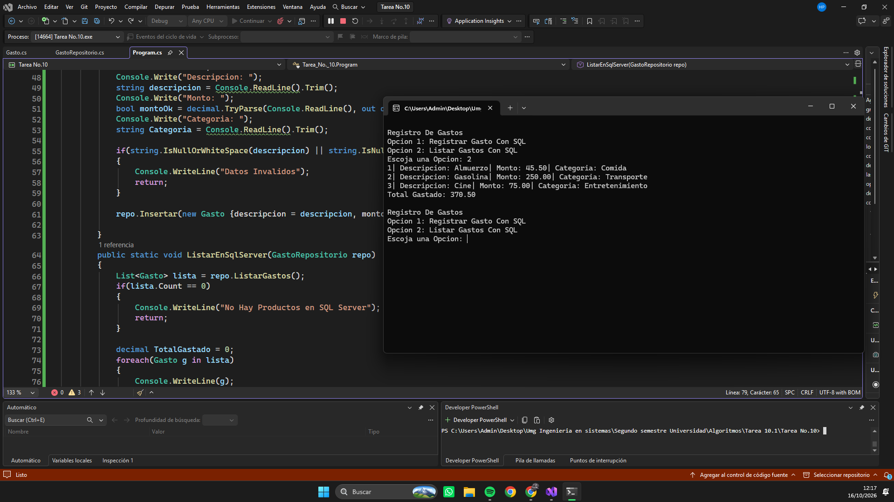
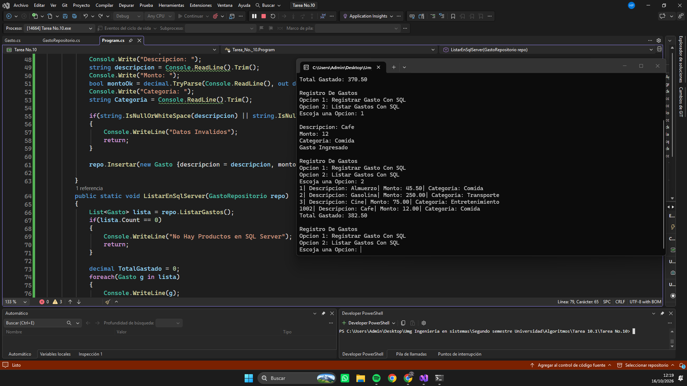
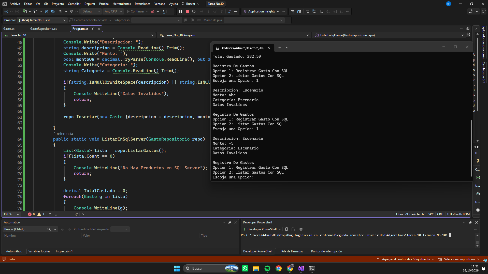
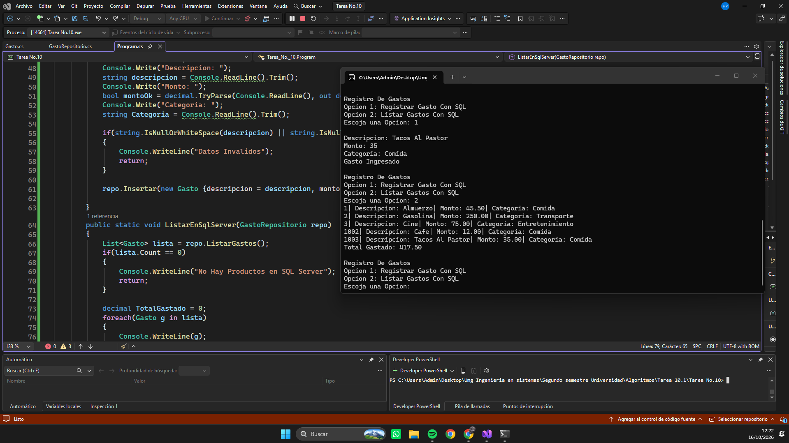
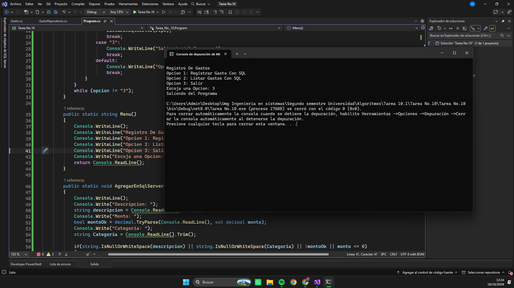

# Tarea No.10 Repositorio de Gastos

## Descripción

Programa desarrollado en C# que utiliza:

- Cadena de conexion a Base de datos
- INSERT INTO VALUES
- DELETE FROM
- Creacion de GastosDB en (localdb)\MSSQLLocalDB
- using
- SqlConnection
- SqlCommand
- SqlDataReader
- .ExecuteReader()
- .Read
- .Parameters.AddWithValue
- @Valor
- .GetInt32()
- .GetString()
- .GetDecimal()
- Interpolacion
- Ternario
- if

## Cómo ejecutar

- Abrir el proyecto en Visual Studio Community.
- Presionar **F5**.

O desde la terminal:

## Capturas
- Ejecucion de los Gastos ya Hechos

- Registrando Nuevo Gasto

- Registrar datos Invalidos

- Registrando Tacos Al Pastor

- Extra Mostrando Opcion Salir (Se me olvido console.write)

## Video Explicativo
- https://drive.google.com/file/d/1a0BZn9WAUusj28V5EjcaI99FU0E9djJs/view?usp=sharing